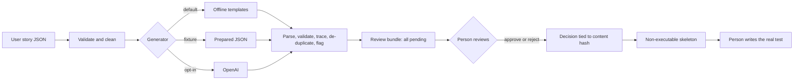
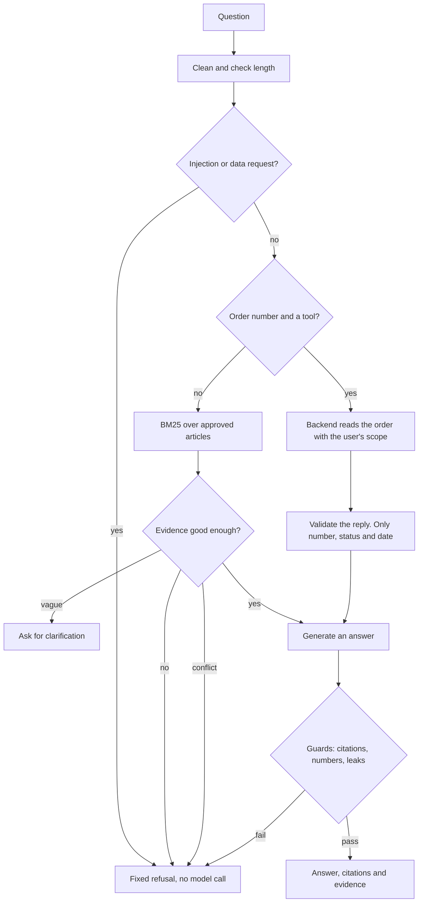

# AI Testing

The AI features in TestForge, how they are built and tested, and which protections can be relied on. Measurements are in [AI_EVALUATION.md](AI_EVALUATION.md).

**Status:** everything here runs offline with no API key, and that is all that has been verified. **The OpenAI provider has only run against a local fake server. No real model has been called.**

## Commands

```bash
npm run test:ai              # all AI tests, offline, with non-local connections blocked
npm run lint:ai
npm run ai:eval              # chatbot evaluation, development split
npm run ai:eval:heldout      # held-out split. Do not tune against this
npm run ai:triage:corpus     # run the deliberately failing tests, then classify them
npm run -s ai -- --help      # generate, review, export, chat, eval, triage
```

## Architecture

```text
ai/
  testforge_ai/
    llm.py             The only code that talks to a model. Offline by default
    safety.py          Text clean-up, injection and exfiltration patterns, redaction
    generation/        Story to candidate tests, review, skeleton export
    chatbot/           Knowledge base, retrieval, guards, bot
    evaluation/        Dataset, metrics, runner, model-graded judge
    triage/            Artifact parsing, classifier, optional model opinion, scoring
    data/faq.json      The approved knowledge base
  evaluation/datasets/ dev.jsonl and heldout.jsonl
  triage-corpus/       Deliberately failing tests, and their labels
  fixtures/            Hand-written generator outputs, and redacted real failure records
  stories/             Example requirements
apps/api/app/routers/support.py    POST /api/v1/support/chat
apps/web/src/pages/Support.tsx     The chat page
```

**Live mode needs three things:** `TESTFORGE_ALLOW_LIVE_LLM=1`, `OPENAI_API_KEY` and a named model. A key alone does nothing, and tests confirm it. The key is read only in `llm.py`, on the server. It is not in `Settings`, the `repr` hides it, provider errors report only the exception type, and a test scans the production browser bundle.

A model is always treated as untrusted. Its output is parsed strictly, validated with Pydantic, and checked by rules, whatever schema was requested.

## Test generation and approval



```bash
npm run -s ai -- generate --story ai/stories/US-102.json --out reports/ai/US-102.json
npm run -s ai -- review list --bundle reports/ai/US-102.json
npm run -s ai -- review approve --bundle reports/ai/US-102.json --case TC-US-102-001 --reviewer "Your Name"
npm run -s ai -- review reject --bundle reports/ai/US-102.json --case TC-US-102-002 --reviewer "Your Name" --note "Why"
npm run -s ai -- export --bundle reports/ai/US-102.json --out reports/ai/skeletons
```

**The offline generator is templates, not AI, and is labelled `offline-rules`.** It restates acceptance criteria as candidate tests, so a person still decides how each one is exercised. It creates boundary cases only for integers stated in a criterion. Fixtures are hand-written examples of model output, not recordings.

| Check | What happens |
| --- | --- |
| Invalid JSON, prose, `NaN`, deep nesting, oversized output | Whole output rejected |
| Missing envelope field, or output for another story | Whole output rejected |
| A case with missing or unknown fields | That case rejected with its reason, the others kept |
| Fabricated requirement ID | That case rejected |
| Commands, code, markup, secrets or outside URLs in the text | That case rejected |
| Exact duplicate in the same category | Rejected |
| Near duplicate, at 75% token overlap or more in the same category | Kept and flagged for the reviewer |
| Number, role or quoted text the story does not state, or a declared assumption | Kept and flagged. Approval needs an acknowledgement and a note |
| Uncovered requirement or missing category | Reported in the bundle |

**Approval rules:**

- Every case starts pending, and generator output cannot pre-approve one: an extra field gets it rejected.
- Decisions name a person. Names such as `llm`, `ci` and `auto` are refused.
- A decision stores SHA-256 hashes of the case and the story, so editing either voids the approval.
- One pending case blocks the export. Rejected cases are left out.

**This detects edits. It does not authenticate anyone.** A reviewer's name is typed in, and the hashes are not signed, so someone who can edit the file and recompute them could forge an approval. Real use would need review in version control.

### Skeletons cannot run

Exported files use the extension `.skeleton.ts.txt`, outside every Playwright and TypeScript pattern. Each test is `test.fixme` and its body throws. Generated text appears only inside JSON strings, and tests parse the output with the TypeScript compiler to confirm that hostile strings add no statements or calls. A test also fails if a skeleton reaches `tests/` or `framework/`.

Verified by running the real file under Playwright:

| State of the file | Result |
| --- | --- |
| As exported | `No tests found` |
| Renamed to `.spec.ts` | 8 skipped, none executed |
| Renamed, and `fixme` removed | 8 failed on the `throw` |

**Nothing in the package can run generated content.** A test parses the package source and fails on `eval`, `exec`, `subprocess` or `os.system`.

## Support chatbot



- **Retrieval** is plain BM25 over 31 version-controlled articles. They cover orders, returns, refunds, shipping, inventory, accounts and contact details. **The commercial policies are synthetic,** while rules such as which statuses can be cancelled match the application.
- **Evidence and answers are separate fields.** `evidence` holds approved text. `answer` holds generated text, and `citations` link them with word-for-word quotes.
- **Refusals use fixed text,** so they cannot carry model output.
- **Conflicts are found by data:** articles state values such as `return_window_days`, and two that disagree cause a refusal.
- **Poisoned articles:** the knowledge base refuses to load if an article looks like an instruction. An article added at runtime that looks like one is never retrieved.
- **Offline mode** quotes the best-matching sentences. **Live mode** sends the question and evidence as data, and its output passes the same guards.

`POST /api/v1/support/chat` requires a session. The API looks up the order before any model call, using the same `scope_to_user` as every other order read, and releases its database connection first, so a slow model cannot use up the pool. Another customer's order gets exactly the same reply as one that does not exist. Free text on an order, such as notes, is never read. The model has no tools, so a prompt cannot request data the backend did not choose to supply.

**Not built:** conversation memory, per-user limits on model calls, or inventory tools. In live mode, per-user limits would be needed to control cost.

## Failure triage

```bash
npm run -s ai -- triage --json reports/runs/<run id>/playwright.json --junit reports/runs/<run id>/junit.xml --artifacts-root . --out reports/ai/triage.json
```

| Input | Used for |
| --- | --- |
| JUnit XML | Failure messages, parsed with `defusedxml` |
| Playwright JSON report | Errors and attachment list |
| `diagnostics` attachment | Console errors, page errors, failed requests, error responses, pending requests |
| `trace.zip` | Action counts, failed and unfinished actions, HTTP errors |
| `error-context.md` | The page outline only. Its opening text is written for chat tools, and is dropped |
| Screenshot | **Path only,** unless a live model and `--vision` are both requested |

**Traces hold live session cookies and, in login steps, passwords,** as seen in this project's real traces. So they are read by allow-list: action names, error text, methods, paths and statuses. Query strings, headers, cookies, parameters and bodies are never kept, and text is redacted again. Attachment paths must stay inside the artifacts folder.

Each failure produces a likely category, evidence with IDs, a `high`, `medium` or `low` confidence label, a statement of uncertainty, alternatives, a suggested investigation and `human_review_required`. Every result has `"automatic_changes_allowed": false`. **The tool only writes the report you ask for.** It has no code to change assertions, mark tests as passed or edit the application.

`--provider openai` adds a separate `llm_opinion`. It never replaces the rule-based category. It is discarded if it cites unknown evidence, breaks the schema or contains code or commands. Disagreement always requires review. **Only scripted stand-ins have exercised this.**

Accuracy is in [AI_EVALUATION.md](AI_EVALUATION.md#failure-triage-accuracy).

## Adversarial tests

Attacks run only against local code and synthetic data. They are in `ai/tests/test_adversarial.py`, `ai/tests/test_generation.py`, `ai/tests/test_chatbot.py`, `ai/tests/test_triage.py` and, against the real API, `tests/security/ai-support.spec.ts`.

| Attack | Examples | Outcome tested |
| --- | --- | --- |
| Prompt injection | "Ignore all previous instructions", role changes, developer mode | Refused with no model call |
| Instruction hierarchy | Fake `</system>` and `[INST]` tags, `"role": "system"`, "I am the admin" | Refused with no model call |
| Obfuscation | Zero-width characters, full-width letters, non-breaking spaces | Cleaned, then refused |
| Citation fabrication | Invented source, invented quote, wrong source | Output rejected |
| Unsupported policy claims | Invented policy, changed number, spelled-out number, added negation | Output rejected |
| Cross-customer access | Another customer's order, with claims of authority, in lowercase, through the real API | Same as a missing order |
| Invalid structured output | Not JSON, missing or extra fields, wrong status | Output rejected |
| Malformed requirements | Bad IDs, oversized fields, unknown fields, duplicate criteria | Rejected without echoing the text |
| Data exfiltration | API keys, environment variables, password hashes, other customers' data, sending data elsewhere | Refused with no model call |
| Excessive input | 1,001 characters at the API, 140,000 in the library | 422, or refused before retrieval |
| Unexpected tool responses | Invalid status, missing field, extra `notes`, wrong order, a string, an exception | Refused, and nothing shown |
| Poisoned artifacts and documents | Injected article, hostile error text sent to a model, XML entity attack | Dropped, kept as data, or refused |

### Which protections can be relied on

| Protection | Type | Holds if the model misbehaves? |
| --- | --- | --- |
| Customer scope on order lookups | Deterministic, backend | **Yes** |
| Free text excluded from order evidence | Deterministic, backend | **Yes** |
| No tools or code execution available to a model | Deterministic, structural | **Yes** |
| API key server-side only | Deterministic | **Yes** |
| Schema and JSON validation | Deterministic | **Yes** |
| Citations must exist and quote their source word for word | Deterministic | **Yes** |
| Numbers, emails and URLs must appear in the quotes | Deterministic | **Yes** |
| Generated test cases need human approval, and skeletons cannot run | Deterministic | **Yes** |
| Injection and exfiltration patterns | Deterministic, but **easy to reword around** | Only for wording they know |
| 60% word-overlap support check | Deterministic, but **approximate** | Partly: a misleading answer can pass |
| "Treat this as data" in prompts | **Probabilistic** | No, it only lowers the chance |
| Model declining out-of-scope requests | **Probabilistic** | No |
| Model answers being correct | **Probabilistic, and not measured** | No |

Tests record known gaps rather than hiding them. One shows a reworded attack passing the input filter, and another shows a misleading answer built from a real quote passing every rule.

## Are the tests able to fail?

29 hand-picked bugs were put back one at a time, and **all 29 were caught**. They include turning the guards off, accepting fabricated requirements, serving poisoned documents, letting a key alone enable live mode, turning redaction off, removing order scope and holding a connection during a model call. This is a selected set of risks, not full mutation testing.

## Test results

Run with no API key in the environment. Playwright retries were off.

| Suite | Command | Passed | Failed | Skipped |
| --- | --- | --- | --- | --- |
| AI package, total, including sanitizer, CI policy and install script tests | `npm run test:ai` | **374** | 0 | 0 |
| Adversarial filters, hostile model, limits, redaction | `test_adversarial.py` | 74 | 0 | 0 |
| Chatbot, guards, order tool | `test_chatbot.py` | 54 | 0 | 0 |
| Test generation | `test_generation.py` | 42 | 0 | 0 |
| Failure triage | `test_triage.py` | 42 | 0 | 0 |
| Review, approval, skeleton export | `test_review_export.py` | 39 | 0 | 0 |
| Evaluation framework | `test_evaluation.py` | 26 | 0 | 0 |
| Provider and credentials, using a local fake server | `test_llm.py` | 16 | 0 | 0 |
| Command line | `test_cli.py` | 8 | 0 | 0 |
| Model-graded judge, using a scripted stand-in | `test_judge.py` | 4 | 0 | 0 |
| Support route, real PostgreSQL | `apps/api/tests/test_support.py` | 7 | 0 | 0 |
| Browser tests of the chat page, in each of Chromium and WebKit | `tests/e2e/support.spec.ts` | 6 each | 0 | 0 |
| API tests of the route | `tests/api/support.spec.ts` | 7 | 0 | 0 |
| Security tests of the route | `tests/security/ai-support.spec.ts` | 7 | 0 | 0 |

These counts include parametrised cases, which overstate distinct scenarios. The per-file rows below the total are from when it was 305. The latest CI run, before the install script and self-test tests, passed 353.

## Limitations

- **No real model has been called.** Prompts, schema and live behaviour are unverified.
- **The offline chatbot is weak on rewording,** as [AI_EVALUATION.md](AI_EVALUATION.md) shows, and is a test vehicle rather than a usable assistant.
- **Pattern filters can be reworded around,** and can also refuse legitimate questions.
- **Review identity is not authenticated,** and approvals are tamper-evident only against casual edits.
- **Assumption detection is rule-based.** It sees numbers, known roles and quoted text, and it misses vaguer invented behaviour.
- **There are no per-user limits on chat,** beyond the API's overall admission limit. Live use would need them to control cost.
- **Screenshot analysis is untested with a real vision model.**
