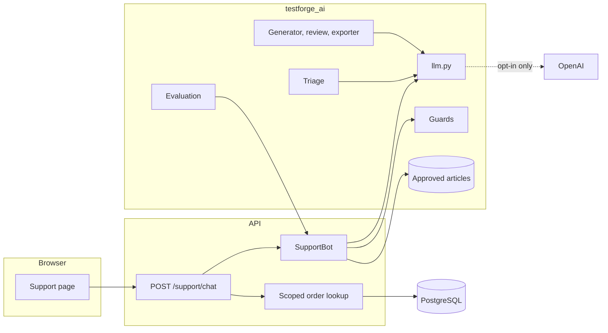

# Architecture

## Application

```
Browser ──> Web app (React, Vite) ──/api proxy──> FastAPI ──> PostgreSQL 17
```

- **Same origin in the browser.** The web server proxies `/api`, so the session cookie needs no CORS.
- **Sessions live on the server.** The cookie is HttpOnly and SameSite=Lax, and only a SHA-256 of the
  token is stored. Logout and privilege changes take effect immediately.
- **Money is integer cents,** with tax in basis points. Database check constraints reject totals that
  do not add up.
- **Business changes and their audit rows commit in one transaction.**

### Request admission

`ConcurrencyLimitMiddleware` admits at most as many requests as the database pool has connections (30), queues up to
`MAX_QUEUED_REQUESTS` more (200) in arrival order, and refuses the rest immediately. A queued request is refused if it waits longer than `MAX_QUEUE_WAIT_SECONDS` (4), and is dropped without running if its client disconnects.

**The admission limit prevents a deadlock.** FastAPI runs synchronous dependencies and endpoints as separate jobs on a 40-thread pool, and a request keeps its database connection between those jobs. Under
a burst, all threads could wait for a connection while all connections were held by requests waiting for a thread, freezing the API until the 30 second pool timeout. Phase 2 found this.

**The queue bound keeps failure fast.** Phase 4 measured the previously unbounded queue: at 800 virtual users, requests waited until clients gave up, and the server still did the work for them. Refused
requests now get a 503 with `Retry-After` and the standard error envelope, before anything runs, so retrying a write is safe. Measurements are in [PERFORMANCE.md](PERFORMANCE.md#overload-behaviour).

`/health` is exempt, so a busy server does not look dead. `/ready` is not, because it uses a database connection, so a flood of checks could otherwise bring back the deadlock.

The limit is per process. Running several API processes means dividing database connections among them. It only applies once the operating system has accepted a connection, and this machine's listen queue is capped at 128.

### Reading a whole list

List pages use offset pagination. A full read cannot, because a row added or retired between requests shifts the offsets
and repeats or skips rows. The order form therefore walks `GET /inventory?sort=id&after_id=...`, which returns each row
that exists throughout the read exactly once.

## Test environments

Each kind of test has its own database, so none can damage another's data.

| Used by | Database | API | Web |
| --- | --- | --- | --- |
| Local development | `testforge` | :8000 | :5173 (dev server) |
| Backend tests (pytest) | `testforge_test` | In process, plus real uvicorn for burst tests | None |
| Playwright | `testforge_e2e` | :8100 | :5273 (production build) |
| k6 | `testforge_perf` | :8200 | None |

All four databases live in one project-local PostgreSQL on :55432. Backend tests refuse any database
whose name does not end in `_test`, Playwright refuses any not ending in `_e2e`, and the k6 runner refuses any not ending in `_perf`.

## Playwright framework

```
tests/e2e/*.spec.ts       What should happen, in business terms
tests/accessibility        axe, semantics, focus and keyboard behaviour, in real browsers
tests/{api,contract,database,security,reliability}    The same, with no browser
        │
framework/fixtures        Sessions per role, per-test data, read-only database
framework/contract        OpenAPI validation and breaking-change detection
        │
framework/pages           One class per screen: actions and locators, no assertions on outcomes
framework/components      Grid, modal, toast, navigation, shared between pages
        │
framework/factories       Creates each test's records through the real API, and cleans them up
framework/helpers         Typed API client, read-only database, network waits, money, CSV
```

### Fixtures

Tests ask for the roles they need, and each one gets its own browser context and server-side session:

```ts
test("...", async ({ manager, buyer, data, db }) => {
  const product = await data.product({ priceCents: 1000, stock: { YYZ1: 5 } });
  await manager.app.orders.goto();   // a page object on the manager's own browser
  await manager.api.me();            // the API, on that same session
  expect(await db.stock(product.id, "YYZ1")).toBe(5);
});
```

| Fixture | Scope | Provides |
| --- | --- | --- |
| `admin`, `manager`, `viewer` | Test | Seeded account, freshly logged in through the API |
| `buyer` | Test | Customer-scoped Viewer, with a customer and user created for this test |
| `anon` | Test | A browser nobody has signed in to |
| `signIn` | Test | Opens another session for any credentials, such as a user the test created |
| `data` | Test | Factory for the test's records, with automatic cleanup |
| `setupApi` | Test | Admin API client with no browser, used by `data` |
| `db` | Worker | One read-only database connection |

**Login goes through the API, not saved files.** Each test logs in with `APIRequestContext` and passes
the resulting cookie to a new browser context. No session is shared between tests, so a test can log
out, or expire its own session, without affecting any other. No auth state is written to disk.

**The teardown also checks for crashes.** An uncaught error in any page fails the test, even if the
visible assertions passed.

### Page objects

- **Locators prefer roles and labels:** `getByRole` and `getByLabel`, with test IDs for data the user
  reads but no role describes. Fields in a dialog are scoped to it, because the page behind can have
  fields with the same labels.
- **Actions wait for their own API response.** `whileWaitingFor` registers the wait before the action
  starts, so a fast response cannot be missed. Filtering waits for a response with the exact parameters
  the form should produce, so a stale response from an earlier request cannot satisfy it.
- **`BasePage` is deliberately small.** It only holds what every page shares (toasts). A deep hierarchy
  would add indirection without removing duplication.

### Test isolation

| Risk | How it is handled |
| --- | --- |
| Name collisions between workers | Names derive from a hash of test ID, retry and repeat index. This is deterministic and unique per attempt and browser |
| Shared mutable records | Every test that changes data creates its own customer and products. Seeded records are only read |
| Global counts moving during a run | Assertions are scoped to the test's own customer or SKU. Moving lists such as the audit page are checked by shape only, and audit content is checked in the database by entity ID |
| Cleanup hitting another worker | `TestData` only touches the IDs it recorded creating. A framework test confirms a seeded product is left unchanged |
| Leftovers between runs | Global setup reseeds `testforge_e2e` at the start of every run |
| Verification changing data | `ReadOnlyDb` logs in as the SELECT-only role `testforge_e2e_reader`, with read-only mode on as well. Tests confirm writes fail even with that mode switched off |

Cleanup cancels orders that can still be cancelled, retires products and deactivates users. Customers
have no delete operation, and settled orders stay as history; both last until the next reseed.

The framework's only direct database write is `expireSession`, which ages one session, found by the
hash of the calling test's own cookie. Waiting out a real session lifetime would make that test
impractical.

### Service test fixtures

`framework/fixtures/api.ts` extends the browser fixtures for tests with no browser. They call the API directly on :8100.

| Fixture | Provides |
| --- | --- |
| `asAdmin`, `asManager`, `asViewer` | A seeded account logged in through `APIRequestContext`, as a typed client |
| `asBuyer`, `newBuyer` | Customer-scoped Viewers, each with a customer created for this test |
| `loginAs` | A new session for any credentials |
| `anonymous` | A client with no session |
| `withCookie` | A client presenting an exact cookie value, for replaying old or forged tokens |
| `unchecked` | No contract check, for paths the spec deliberately omits |
| `observeContract` | Validates every response above against the spec, and fails the test on any violation |

Global teardown writes the operations and statuses reached to `reports/runs/<run id>/contract/coverage.md`.

### Failure diagnostics

Failed browser tests keep a trace, screenshot, video and error context, in that run's own folder. They also attach `diagnostics`, with the test title, project, browser version, worker, retry, duration, console errors, page errors, failed requests and
error responses, including each response's request ID, which links it to the API's log. It records URLs and statuses only, with no cookies, headers or bodies.

### Accessibility helpers

`framework/helpers/accessibility.ts` runs axe with no rule disabled and attaches each result. It also checks what axe does not: heading hierarchy, label associations, and a visible focus indicator at each Tab stop.

### Failure triage corpus

`playwright.triage.config.ts` runs `ai/triage-corpus/`, a set of deliberately failing tests that give the triage tool real artifacts. It has its own output folder and is never part of a normal run. Failure diagnostics also list requests still pending at failure, because that separates a timing failure from a missing element.

### Project configuration

Projects are defined in `playwright.config.ts`: `chromium`, `firefox`, `webkit`, a browserless `framework` project for
checks on the helpers themselves, `accessibility` in Chromium, `keyboard-webkit` and `keyboard-firefox`, and `api`, `contract`, `database`, `security` and `reliability`. `reliability` runs one
test at a time, so bursts do not add up past the operating system's connection queue.

| Setting | Value | Override |
| --- | --- | --- |
| Workers | 50% of CPU cores (2 in CI) | `E2E_WORKERS=4` or `E2E_WORKERS=25%` |
| Retries | 0 everywhere | `E2E_RETRIES=1`, to diagnose a flaky test |
| Traces, screenshots, video | Kept for failures only | |

A retried test that passes is reported as flaky, not passed, so retries cannot hide a problem.

Playwright only records video automatically for its built-in `page` fixture. Role sessions open their
own contexts, so the fixture records and keeps video itself. Traces and screenshots do apply to those
contexts automatically. A deliberate failure with two sessions confirmed all three are captured.

## AI modules

`ai/testforge_ai` is one Python package shared by a command line and a thin API route. It holds test generation, the support chatbot, the evaluation framework and failure triage. Detail is in [AI_TESTING.md](AI_TESTING.md).



**Design decisions:**

- **Offline by default.** Nothing needs a key. `OpenAIProvider` can only be created with an explicit allow flag, a key and a named model, so a key that happens to be in the environment does nothing.
- **Authorization stays in the backend.** The route resolves an order with the same `scope_to_user` as every other read and passes the bot only a validated number, status and date. The model has no tools.
- **No connection is held during a model call.** The route rolls back before calling the bot. Admission allows as many requests as there are connections, so a slow model holding them would bring back the Phase 2 starvation problem.
- **A model is untrusted.** Output is parsed, validated and checked by rules, and only then shown. Refusals use fixed text.
- **Plain BM25, with no vector database.** The purpose is testing AI systems, and a few dozen short articles do not need more.
- **A failed configuration stops startup.** A live provider that is not fully configured fails when the server starts, not on a customer's request.

## Delivery

Docker and CI have run on GitHub, with three fully green runs. See [DOCKER.md](DOCKER.md) and [CI_CD.md](CI_CD.md).

- **External PostgreSQL mode:** `EXTERNAL_POSTGRES=1` makes `db-local.sh` only create missing databases on a server someone else runs, such as a CI service container on port 55432, so the default URLs still apply.
- **External servers mode:** `E2E_EXTERNAL_SERVERS=1` stops Playwright starting the API and web app, and `E2E_API_URL` and `E2E_BASE_URL` say where they are. In Docker, `E2E_SKIP_SEED=1` leaves seeding to a one-shot service.
- **Per-run reports:** each run writes to `reports/runs/<run id>/`, because Playwright empties its output folder when it starts. Only a sanitized copy can be published.
- **Testing away from localhost:** the Docker stack serves plain HTTP on a non-localhost name, which browsers treat as an insecure context. Native jobs use localhost, which browsers treat as secure, so only Docker exposed a bug in code that relied on a secure-context API.
- **API keep-alive:** test servers and the API image use a 75-second keep-alive. With uvicorn's default of 5, a client reusing an idle connection can be reset.

