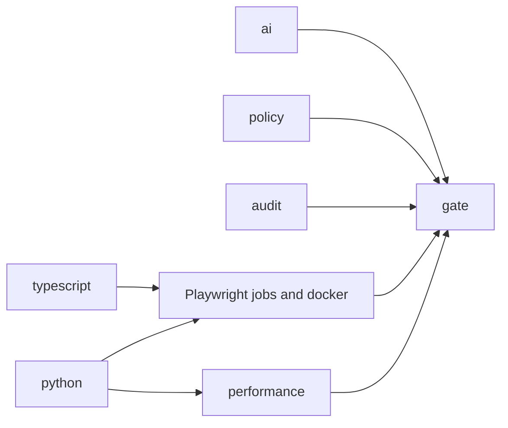

# CI/CD

**Status: configured, and never run on GitHub.** The repository has no remote and nothing has been pushed, so there is **no CI result of any kind, and nothing here has run on Linux.** Firefox remains unverified until the Firefox job passes. Expect the first run to find problems that a Mac cannot show.

## What was checked locally

| Check | Result |
| --- | --- |
| `actionlint` 1.7.12 on all workflows | No findings |
| `npm run ci:policy`, plus tests that the policy catches bad changes | Passed |
| The CI test commands on macOS, in a fresh copy, against a separate empty PostgreSQL on the CI port, with `CI=1`, `EXTERNAL_POSTGRES=1`, 2 workers and retries off | Passed. See [TEST_RESULTS.md](TEST_RESULTS.md#ci-simulation-on-macos) |

**That simulation is not CI.** It used macOS, Mac browsers and no containers. It proves that the databases, external-PostgreSQL mode, commands and count gates work together. It cannot show Linux behaviour, and it left out the Firefox, Docker and audit jobs.

## Jobs

`.github/workflows/ci.yml` runs on every pull request and on pushes to `main`. Each job is on a fresh `ubuntu-24.04` runner.

| Job | What it runs | Passing tests required |
| --- | --- | --- |
| `typescript` | Type check, ESLint, production build | n/a |
| `policy` | `ci:policy`, `actionlint`, `hadolint` | n/a |
| `python` | Ruff, backend pytest, committed spec matches the code | pytest's own result |
| `ai` | Ruff, AI pytest, offline evaluation against the baseline | pytest's own result |
| `api-contract` | `api`, `contract` | 254 |
| `database-security` | `database`, `security`, `reliability` | 163 |
| `chromium` | `framework`, `chromium` | 70 |
| `firefox` | `firefox` | 64 |
| `webkit` | `webkit` | 64 |
| `accessibility` | `accessibility`, `keyboard-webkit`, `keyboard-firefox` | 148 |
| `performance` | Short k6 runs with gates | k6 thresholds |
| `docker` | Build, startup and persistence check, suites in the test stack | 500 |
| `audit` | npm audit, pip-audit, gitleaks over all history | n/a |
| `gate` | Fails unless every job above **succeeded** | n/a |



The browser and service jobs wait for `typescript` and `python`, because they are slow, and a type error or a backend failure makes their results less useful. Shared steps are in `.github/actions/setup-test-env` and `.github/workflows/playwright-job.yml`.

**Other workflows, which run only when started by hand:**

- `performance-stress.yml`: all k6 scenarios at full length.
- `webkit-soak.yml`: repeats the WebKit suite at 2 and 4 workers, keeping sanitized evidence for 30 days.

There is deliberately **no workflow for live LLM evaluation.** It is run by hand, as described in [AI_EVALUATION.md](AI_EVALUATION.md#live-evaluation).

## Nothing fails quietly

| Risk | Protection |
| --- | --- |
| A suite silently stops running | `reports:check` fails if too few tests passed, or if any were skipped or flaky |
| A job is skipped | `gate` requires `success`, so `skipped` fails it |
| A failure is retried away | `E2E_RETRIES` is `0` everywhere, and a policy rule enforces it |
| A command's failure is ignored | The policy rejects `\|\| true`, `set +e` and `continue-on-error` |
| Evaluation drifts | `scripts/check_eval.py` fails on any change from `ai/evaluation/baseline.json`, in either direction |
| The API spec drifts from the code | The `python` job regenerates it, and fails on any difference |

## Reproducibility

- **Versions:** Node from `.nvmrc`, Python from `.python-version`, `npm ci`, and lock files for Python.
- **Databases:** each job has its own PostgreSQL service container, pinned by digest, with a health check and the same collation as the local cluster. It maps to port 55432, so the default URLs apply. `scripts/create_databases.py` creates the databases.
- **Browsers:** `npx playwright install --with-deps <browser>`, which is the supported way to get a browser and its Linux system packages.

## Artifact retention

Playwright empties its output folder when a run starts, which destroyed the Phase 4 WebKit trace. Each run now has its own folder:

```text
reports/runs/<run id>/
  junit.xml, playwright.json, html/, contract/
  test-results/<test>/  trace.zip, screenshots, video, error-context.md
reports/latest-run.txt
```

Locally, the run ID is a timestamp plus the process ID. In CI it names the job. Set `TESTFORGE_RUN_ID` to choose one.

**Raw artifacts hold credentials.** Real traces here contained session cookies and passwords. So they are never uploaded, and the policy rejects any upload of `reports/runs`, `html` or `test-results`. On failure, `npm run reports:sanitize` writes a copy to `reports/sanitized/<run id>`, and only that is uploaded.

| Sanitizer step | What it does |
| --- | --- |
| Left out | The HTML report, because it embeds raw traces |
| By structure | Cookie arrays, sensitive headers, password keys, JSON request bodies, values filled into password fields, password inputs in DOM snapshots |
| By value | Each secret found is replaced everywhere else in the trace, including bundled source |
| Check afterwards | A trace that still holds a secret is **dropped and reported**, not published |

**Retention:** failure evidence 14 days, soak evidence 30 days, measurements 14 or 30 days. Locally, `npm run reports:prune` keeps the newest 20 runs and anything from the last 14 days. It never removes a run with failures unless given `--include-failed`.

**Limits:** images and video cannot be scanned. Password fields are masked on screen, but any other visible data remains. All data in this project is synthetic.

### Verification, with an intentionally failing test

`ai/triage-corpus/artifact-check.spec.ts` signs in through the UI, typing a real password, then fails with a console error and a 500 response. Results are in [TEST_RESULTS.md](TEST_RESULTS.md#artifact-retention).

## Security

| Control | Detail |
| --- | --- |
| Permissions | `contents: read` at the top of every workflow, and write permission fails the policy |
| Pinned Actions | Every third-party Action is pinned to a full commit SHA, with its version in a comment |
| Checkout | `persist-credentials: false` |
| Secrets | No workflow uses any repository secret, and the policy rejects `secrets.` |
| Untrusted code | No `pull_request_target`. Inputs reach scripts through environment variables |
| No live LLM | `TESTFORGE_ALLOW_LIVE_LLM` is `0`, and the policy rejects a key or enabling it |
| Secret scanning | gitleaks over all history. The allow-list holds only exact synthetic values |
| Dependencies | `npm audit` and `pip-audit`. Dependabot is **temporarily off** while CI is first verified, because each of its pull requests runs full CI. To turn it on, rename `.github/dependabot.yml.disabled` to `.github/dependabot.yml` |

### Dependency findings

Results are in [TEST_RESULTS.md](TEST_RESULTS.md#dependency-and-secret-scans).

**The 13 moderate npm findings are one advisory.** [GHSA-g3hv-75wg-m249](https://github.com/advisories/GHSA-g3hv-75wg-m249) is a denial of service in `minimatch` below 11.0.1 from crafted glob patterns. It reaches this project through two development tools: ESLint and `typescript-eslint` (10.2.6), and `openapi-typescript` (5.1.9).

- **Scope:** development only, and not in the production dependencies or the images' runtime. These tools only process glob patterns written in this repository, so an attacker would need to already be able to change the repository.
- **Not fixed, on purpose:** `npm audit fix --force` proposes **downgrading** ESLint to 4.0.0 and `openapi-typescript` to 6.7.6, which would break the tooling. Forcing `minimatch` 11 is outside what ESLint declares it supports.
- **Gate:** production findings fail at any level, and development findings fail at high or above, so a new serious finding still stops CI. The fix is to update when those tools move to a fixed `minimatch`.

## Setting it up

**Pushing needs your approval, and has not been done.**

```bash
git remote add origin git@github.com:<you>/testforge-ai.git
git push -u origin main
```

Then read the first run closely, and start `webkit-soak.yml` by hand. No secrets need configuring. To make `gate` a required check, add a branch protection rule. Artifacts on a public repository can be downloaded by anyone logged in to GitHub.

## Limitations

- **Never run,** as stated above. Timeouts, runner speed and browser behaviour on Linux are all unknown.
- **Linux differences are likely.** Fonts and layout can change reflow tests, and Firefox focus behaviour has never been observed by these tests. A WebKit keyboard helper changes behaviour by platform, and its Linux path has never run.
- **The `min-tests` numbers need updating** when tests are added or removed, and this is deliberate.
- **`pip-audit` uses `--no-deps`,** because the lock files are unhashed. It checks exactly what is listed in them.
- **Shared runners vary,** so performance limits in CI are loose. See [PERFORMANCE.md](PERFORMANCE.md#quality-gates).
