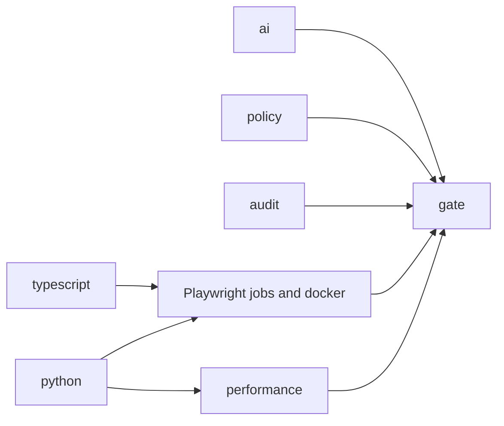

# CI/CD

**Status: the latest run is fully green.** [CI run 41936962432](https://github.com/Dileep5/testforge-ai-sdet-automation/actions/runs/41936962432), at commit `d61c036`, passed all 14 jobs, including the final gate, in 15m 33s and about 44 job minutes. [Sanitizer self-test run 41935807067](https://github.com/Dileep5/testforge-ai-sdet-automation/actions/runs/41935807067) also passed. Results are in [TEST_RESULTS.md](TEST_RESULTS.md#latest-verified-evidence).

Of 7 complete CI runs, 4 were green, within about a day, so this history does not show long-term stability. The 3 failed runs came from a linter setting, defects in the Docker test script and an overload test, a real payment bug found by Docker, and a slow package mirror. All are [explained with their fixes](TEST_RESULTS.md#first-github-actions-run).

## Jobs

`.github/workflows/ci.yml` runs on every pull request and on pushes to `main`. Each job is on a fresh `ubuntu-24.04` runner.

| Job | What it runs | Passing tests required |
| --- | --- | --- |
| `typescript` | Type check, ESLint, production build | n/a |
| `policy` | `ci:policy`, `lint:scripts` (Ruff, `bash -n`, shellcheck, `node --check`), `actionlint`, `hadolint` | n/a |
| `python` | Ruff, backend pytest, committed spec matches the code | pytest's own result |
| `ai` | Ruff, AI pytest, offline evaluation against the baseline | pytest's own result |
| `api-contract` | `api`, `contract` | 254 |
| `database-security` | `database`, `security`, `reliability` | 163 |
| `chromium` | `framework`, `chromium` | 73 |
| `firefox` | `firefox` | 67 |
| `webkit` | `webkit` | 67 |
| `accessibility` | `accessibility`, `keyboard-webkit`, `keyboard-firefox` | 148 |
| `performance` | Short k6 runs with gates | k6 thresholds |
| `docker` | Build, startup and persistence check, suites in the test stack | 500 |
| `audit` | npm audit, pip-audit, gitleaks over all history | n/a |
| `gate` | Fails unless every job above **succeeded** | n/a |



The browser and service jobs wait for `typescript` and `python`, because they are slow, and a type error or a backend failure makes their results less useful. Shared steps are in `.github/actions/setup-test-env` and `.github/workflows/playwright-job.yml`.

**Other workflows, which run only when started by hand:**

- `performance-stress.yml`: all k6 scenarios at full length.
- `sanitizer-self-test.yml`: proves the sanitizer without failing any application test. See [below](#sanitizer-self-test). [Its one run passed](https://github.com/Dileep5/testforge-ai-sdet-automation/actions/runs/41935807067).
- `webkit-soak.yml`: repeats the WebKit suite at 2 and 4 workers, keeping sanitized evidence for 30 days. [Its one complete run passed 650 of 650](TEST_RESULTS.md#webkit-soak), before the 2 newest browser tests.

There is deliberately **no workflow for live LLM evaluation.** It is run by hand, as described in [AI_EVALUATION.md](AI_EVALUATION.md#live-evaluation).

## Nothing fails quietly

| Risk | Protection |
| --- | --- |
| A suite silently stops running | `reports:check` fails if too few tests passed, or if any were skipped or flaky |
| A job is skipped | `gate` requires `success`, so `skipped` fails it |
| A failure is retried away | `E2E_RETRIES` is `0` everywhere, and a policy rule enforces it |
| A command's failure is ignored | The policy rejects `\|\| true`, `set +e` and `continue-on-error` |
| Evaluation drifts | `scripts/check_eval.py` fails on any change from `ai/evaluation/baseline.json`, in either direction |
| The API spec drifts from the code | The `python` job regenerates it, and fails on any difference |

## Reproducibility

- **Versions:** Node from `.nvmrc`, Python from `.python-version`, `npm ci`, and lock files for Python.
- **Databases:** each job has its own PostgreSQL service container, pinned by digest, with a health check and the same collation as the local cluster. It maps to port 55432, so the default URLs apply. `scripts/create_databases.py` creates the databases.
- **Browsers:** `npx playwright install --with-deps <browser>`, which is the supported way to get a browser and its Linux system packages.

## Concurrency

A newer push replaces an unfinished run on the same pull request, because only the latest commit there matters. Each push to `main` has a group of its own, so it is never cancelled, never waits, and its result is kept. A pull request and a push to `main` are different events on different commits, so one commit does not run twice. A policy rule enforces this.

## Browser install reliability

**What happened:** in the soak, one job spent 33.8 minutes in setup, because its Ubuntu mirror delivered 114 MB in 32 minutes, at 59.5 kB/s. The job finished at 44.8 of its 45-minute limit. Its sibling took 1.6 minutes. Tests were not involved. The browser cache already worked, because the slow part was the Linux packages from `--with-deps`.

| Option | Assessment |
| --- | --- |
| Run native jobs in the pinned Playwright image | Most reproducible, with no apt at all, and already proven by the Docker job. But it changes each native job: root containers, Firefox's `HOME` rules, Python setup in a container and different database addresses. None of that can be tested locally, and native jobs usefully differ from the Docker job |
| Avoid repeated apt, by caching downloaded packages | **Chosen.** A small change, and the test environment stays the same |
| Bounded timeout with diagnostics | **Chosen, with caching.** It cannot make a slow mirror faster, but it stops one using up the tests' time, and names the cause |
| Raising the job's time limit | Rejected. It only spends more minutes on a stalled download |

**What changed:** `scripts/install-browsers.sh` keeps downloaded `.deb` files in a cached folder, retries failed downloads, stops after 15 minutes (`BROWSER_INSTALL_LIMIT_MINUTES`) with a clear error, and logs how many packages were cached and how long it took. The save happens straight after install, so a later test failure does not lose the download. No test, count, retry or gate changed.

**How the shared cache works:** every browser job installs the system packages for all browsers, even if it runs only one, so the set is the same everywhere and one cache serves every job. The key is the OS image plus Playwright's version, currently `apt-ubuntu24-1.64.1`. An older key with the same OS can be restored as a starting point, and apt then fetches only what is missing. Jobs start together, so on a new key they all download, one saves the cache, and the others log `Unable to reserve cache`, which is harmless.

| Observation | [First version](https://github.com/Dileep5/testforge-ai-sdet-automation/actions/runs/41928911349) | [Filling the cache](https://github.com/Dileep5/testforge-ai-sdet-automation/actions/runs/41933122691) | [Using the cache](https://github.com/Dileep5/testforge-ai-sdet-automation/actions/runs/41936962432) |
| --- | --- | --- | --- |
| Time limit | Worked: stopped at 900 s, with an error naming the likely cause | Not reached | Not reached |
| Install times | 20, 24 and 36 s, and 1 job stopped at 900 s | 28, 30, 32 and 87 s | **22, 22, 27 and 31 s** |
| Slowest 114 MB download | Over 15 minutes, incomplete | 42 s | **None needed** |
| Cache key | **Flaw:** `env.ImageOS` is empty in a composite action, so the OS was missing | Fixed: `apt-ubuntu24-1.64.1` | Same |
| Cache sharing | **Flaw:** one cache per browser list, tied to the whole lock file | Fixed: one cache, tied to Playwright's version | Same |
| Cache saved | 3 separate caches | **1 cache: 181 packages, 114 MB** | Skipped, as it should be after a hit |
| Cache hits | None | None, as all jobs started on a new key | **4 of 4: 181 packages before installing, and `Need to get 0 B/114 MB`** |
| After a failed install | **Flaw:** later steps also failed, burying the cause | Fixed, and **not exercised**, as nothing failed | **Not exercised** |

**Remaining slow-mirror risk:** at least 2 of 30 browser installs have met a very slow mirror. A cache hit avoids the package download, though apt still fetches 10 to 13 MB of package lists from the mirror, and any package that has changed. No mirror was slow in the runs above, so the cache has not yet been seen to rescue a job from one. A miss, such as after a Playwright upgrade, can still meet a slow mirror, which now fails with a clear error at 15 minutes and needs someone to run it again. **If this remains a problem,** the next step is running native jobs in the pinned Playwright image.

## Artifact retention

Playwright empties its output folder when a run starts, which destroyed the Phase 4 WebKit trace. Each run now has its own folder:

```text
reports/runs/<run id>/
  junit.xml, playwright.json, html/, contract/
  test-results/<test>/  trace.zip, screenshots, video, error-context.md
reports/latest-run.txt
```

Locally, the run ID is a timestamp plus the process ID. In CI it names the job. Set `TESTFORGE_RUN_ID` to choose one.

**Raw artifacts hold credentials.** Real traces here contained session cookies and passwords. So they are never uploaded, and the policy rejects any upload of `reports/runs`, `html` or `test-results`. On failure, `npm run reports:sanitize` writes a copy to `reports/sanitized/<run id>`, and only that is uploaded.

| Sanitizer step | What it does |
| --- | --- |
| Left out | The HTML report, because it embeds raw traces |
| By structure | Cookie arrays, sensitive headers, password keys, JSON request bodies, values filled into password fields, password inputs in DOM snapshots |
| By value | Each secret found is replaced everywhere else in the trace, including bundled source |
| Check afterwards | A trace that still holds a secret is **dropped and reported**, not published |
| Text or binary | Decided by content, because real traces hold text with no file extension |

**Retention:** failure evidence 14 days, soak evidence 30 days, measurements 14 or 30 days. Locally, `npm run reports:prune` keeps the newest 20 runs and anything from the last 14 days. It never removes a run with failures unless given `--include-failed`.

**Limits:** images and video cannot be scanned. Password fields are masked on screen, but any other visible data remains. All data in this project is synthetic.

### Sanitizer self-test

The sanitizer runs only after a failure, so a green run never exercises it. `sanitizer-self-test.yml` runs only by hand, and takes about 4 job minutes. It fails no application test.

1. It builds a synthetic run with dummy secrets in each place real traces hold them, and confirms the raw copy really contains them.
2. It sanitizes the run, then checks that every secret is gone, the HTML report is left out, a trace that cannot be cleaned is dropped, and the actions, statuses, screenshot and report that diagnose a failure remain.
3. It uploads only the public copy, kept for 7 days.
4. A second job downloads that artifact, and runs the same checks on what was actually uploaded.

**Result:** [run 41935807067](https://github.com/Dileep5/testforge-ai-sdet-automation/actions/runs/41935807067) passed both jobs. All 9 kinds of dummy secret were gone from the uploaded copy and the logs, and the evidence remained. The artifact held 8 files and 1 cleaned trace, with 7-day retention, and no HTML report or uncleaned trace. Details are in [TEST_RESULTS.md](TEST_RESULTS.md#sanitizer-self-test).

**Its scope:** it proves the sanitizer on a synthetic fixture. Real failing traces with the latest fix have been sanitized only locally. The second job uses a separate runner, but the same checking code. It checks text and bytes, so it cannot judge what a real screenshot or video shows.

### Verification, with an intentionally failing test

`ai/triage-corpus/artifact-check.spec.ts` signs in through the UI, typing a real password, then fails with a console error and a 500 response. Results are in [TEST_RESULTS.md](TEST_RESULTS.md#artifact-retention).

## Security

| Control | Detail |
| --- | --- |
| Permissions | `contents: read` at the top of every workflow, and write permission fails the policy |
| Pinned Actions | Every third-party Action is pinned to a full commit SHA, with its version in a comment |
| Checkout | `persist-credentials: false` |
| Secrets | No workflow uses any repository secret, and the policy rejects `secrets.` |
| Untrusted code | No `pull_request_target`. Inputs reach scripts through environment variables |
| No live LLM | `TESTFORGE_ALLOW_LIVE_LLM` is `0`, and the policy rejects a key or enabling it |
| Secret scanning | gitleaks over all history. The allow-list holds only exact synthetic values |
| Dependencies | `npm audit` and `pip-audit`. **Dependabot is deliberately off through public release,** because each of its pull requests runs full CI. The plan is to enable it afterwards, with controlled scheduling and a limit on open pull requests, starting from `.github/dependabot.yml.disabled` |

### Dependency findings

Results are in [TEST_RESULTS.md](TEST_RESULTS.md#dependency-and-secret-scans).

**The 9 moderate npm findings are one advisory.** [GHSA-g3hv-75wg-m249](https://github.com/advisories/GHSA-g3hv-75wg-m249) is a denial of service in `minimatch` from `7.0.0` up to `11.0.1`, through crafted glob patterns. It reaches this project through ESLint and `typescript-eslint`, which use 10.2.6. It was first reported as 13 findings, until the advisory was narrowed, and [the reason is recorded](TEST_RESULTS.md#why-the-npm-count-changed-from-13-to-9). `openapi-typescript` uses 5.1.9, which is no longer in range.

- **Scope:** development only, and not in the production dependencies or the images' runtime. These tools only process glob patterns written in this repository, so an attacker would need to already be able to change the repository.
- **Not fixed, on purpose:** `npm audit fix --force` proposes **downgrading** ESLint from 10 to 9.39.5, which it marks as a breaking change. It earlier proposed 4.0.0. Forcing `minimatch` 11 is outside what ESLint declares it supports.
- **Gate:** production findings fail at any level, and development findings fail at high or above, so a new serious finding still stops CI. The fix is to update when those tools move to a fixed `minimatch`.

## Setting it up

No secrets need configuring. `performance-stress.yml` has never been started. For a public repository, set fork pull requests to need approval before workflows run. To make `gate` a required check, add a branch protection rule. Artifacts on a public repository can be downloaded by anyone logged in to GitHub.

## Limitations

- **A short history:** 7 complete CI runs, 4 of them green, within about a day, so rare or timing-related Linux failures may not have appeared.
- **A slow mirror can still fail a run,** on a cache miss or while fetching package lists. See [Browser install reliability](#browser-install-reliability).
- **Failed install handling has not been exercised on GitHub.**
- **The latest sanitizer fix has run on GitHub only on a synthetic fixture.** A real failing trace would be the first real test.
- **Images and video in artifacts cannot be text-scanned,** and those from the second run have not been reviewed one by one.
- **Dependabot is off through public release,** so pinned versions will go stale until it is enabled.
- **On a public repository,** old run logs and unexpired artifacts become visible too, and fork pull requests can start workflows. See the settings in [Setting it up](#setting-it-up).
- **Performance gates have thin margins on slow runners.** Refusal p95 reached 541 ms of 1,000 ms, so a slow runner could fail without a regression.
- **The `min-tests` numbers need updating** when tests are added or removed, and this is deliberate.
- **`pip-audit` uses `--no-deps`,** because the lock files are unhashed. It checks exactly what is listed in them.
- **Shared runners vary,** so performance limits in CI are loose. See [PERFORMANCE.md](PERFORMANCE.md#quality-gates).
