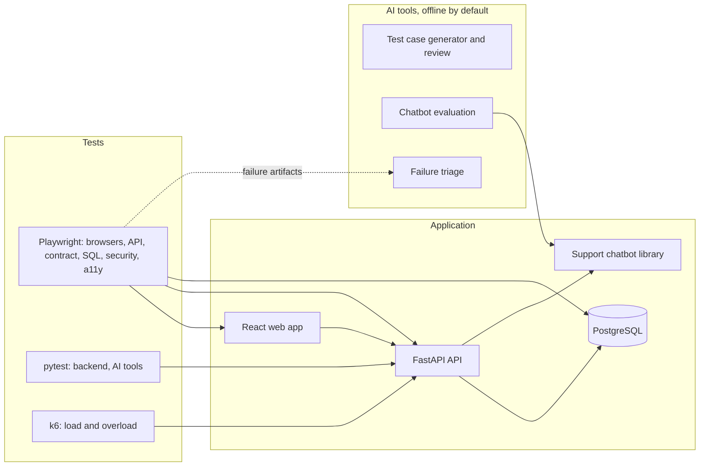

# TestForge AI

A test automation portfolio project: a real commerce application, and the tests, tools and CI that check it across browsers, APIs, the database, security, accessibility, performance and AI features.

**In the latest verified run, all 14 CI jobs passed on Linux, with retries off.** That is one snapshot and not a stability guarantee, and [known limitations](#known-limitations) are listed below. All data is synthetic, and the application is not meant for production.

## What problem this addresses

Test suites often look healthy while proving little: they mock the system they claim to test, pass on a retry, skip quietly, or report numbers nobody can trace. This project is an attempt to do the opposite:

- Tests run against a real API and database, not mocks.
- Retries are off, and a CI job fails if a test is skipped or goes missing.
- Known bugs were deliberately put back to check that tests catch them.
- Reported results link to the run that produced them, and failures are recorded alongside successes.

## Verified evidence

From [CI run 41910311071](https://github.com/Dileep5/testforge-ai-sdet-automation/actions/runs/41910311071) and [WebKit soak run 41913178899](https://github.com/Dileep5/testforge-ai-sdet-automation/actions/runs/41913178899), on Ubuntu 24.04 runners with 2 cores, at commit `3c1a6fd`, on 2026-11-04. Each count is passed, with 0 failed, 0 skipped and 0 flaky.

| Suite | Passed |
| --- | --- |
| Chromium / Firefox / WebKit | 65 / 65 / 65 |
| Framework self-checks | 6 |
| Backend, pytest with 97% line coverage | 197 |
| AI tools | 353 |
| API | 154 |
| OpenAPI contract | 100 |
| PostgreSQL | 44 |
| Security regression | 114 |
| Reliability | 5 |
| Accessibility (axe, semantics, keyboard) in Chromium | 82 |
| Keyboard in Firefox / WebKit | 33 / 33 |
| All except contract, in Docker | 666 |
| k6 performance gates | 22 of 22 |
| WebKit, each test 5 times, at 2 and at 4 workers | 650 |

Counts include parametrised cases, so they overstate distinct scenarios. Full results, including the failed runs before these, are in [TEST_RESULTS.md](TEST_RESULTS.md).

**Testing found real problems.** Examples: a payment button that did nothing on plain HTTP away from localhost, found only by running in Docker; a deadlock between database connections and worker threads under load; and 10 accessibility defects. All are fixed and recorded, with how each was found.

## Architecture



**Stack:** React 19, TypeScript, Vite · FastAPI, Pydantic v2, SQLAlchemy 2, Alembic · PostgreSQL 17 · Playwright, pytest, k6, axe-core · Docker Compose, GitHub Actions · ESLint, Ruff, hadolint, actionlint, gitleaks, pip-audit.

**The application under test** is a fictional B2B order system: roles enforced in the backend, customer-scoped buyers, products, per-warehouse inventory with version checks, multi-line orders with row locks, simulated payments with idempotency keys, an audit log and a support chat page. No real payment or personal data is involved.

Design details are in [ARCHITECTURE.md](ARCHITECTURE.md).

## Test automation capabilities

| Area | What it does |
| --- | --- |
| **Browser** | Page objects and isolated fixtures in strict TypeScript, with data created per test through the real API |
| **API** | Valid and invalid requests for each endpoint, typed from the OpenAPI spec |
| **Contract** | Every response is validated against the generated spec, with breaking-change detection |
| **Database** | Read-only SQL assertions as a SELECT-only role, covering totals, rollback, integrity and audit |
| **Security regression** | Authorization for each operation and role, IDOR, sessions, injection and idempotency abuse, against the local app only |
| **Accessibility** | axe across 41 screen states, plus keyboard, focus and semantics tests |
| **Performance** | 7 k6 scenarios with pass or fail gates, including overload and recovery |
| **Failure evidence** | Each run keeps its own traces, screenshots, video and diagnostics. A sanitizer removes credentials before anything can be published |
| **CI** | Separate jobs, pinned Actions and images, read-only permissions, secret and dependency scans, and a gate that treats skipped jobs as failures |

Coverage by layer is in [TEST_STRATEGY.md](TEST_STRATEGY.md), with [ACCESSIBILITY.md](ACCESSIBILITY.md), [PERFORMANCE.md](PERFORMANCE.md), [CI_CD.md](CI_CD.md) and [DOCKER.md](DOCKER.md) for each area.

## AI-assisted testing and evaluation

**Everything verified here runs offline, and no real language model has been called.** The offline tools are deterministic, so they test the surrounding workflow and safeguards, and they do not show how well an LLM would perform. An OpenAI provider exists, but it needs an explicit opt-in, and has only run against a local fake server.

| Tool | Offline behaviour | Tested safeguards |
| --- | --- | --- |
| **Test case generation** | Templates, not AI, that restate acceptance criteria as candidate tests | Rejects invalid output and fabricated requirements. Requires human approval, and exports skeletons that cannot run |
| **Support chatbot** | Keyword retrieval that quotes approved, synthetic articles | Checks citations against sources, refuses without evidence, and enforces order access in the backend |
| **Evaluation** | 148 questions, split into development and held-out sets | Rule-based metrics with denominators and intervals. Tuning cannot read the held-out set |
| **Failure triage** | Rules over real Playwright artifacts | Output is advice only, with evidence and a review flag. It cannot change tests |

**The results are modest, and are reported as they are.** The offline chatbot got 12 of 23 held-out answers right, and 0 of 8 paraphrases, having scored 23 of 23 on the set it was tuned on. It refused correctly on 41 of 43 held-out questions that needed refusing. Triage classified 33 of 36 held-out failures correctly, but one author wrote those failures and the rules, so that is not real-world accuracy. See [AI_TESTING.md](AI_TESTING.md) and [AI_EVALUATION.md](AI_EVALUATION.md).

## Running it

**You need:** Node 22 or newer (CI uses 24.3.0), and Python 3.12 or newer (CI uses 3.13.5), on macOS or Linux. PostgreSQL is provided locally by a dev dependency. The local setup has been run on macOS arm64. Linux has run through the CI scripts and Docker, and Windows has not been tried.

```bash
git clone https://github.com/Dileep5/testforge-ai-sdet-automation.git
cd testforge-ai-sdet-automation
npm run setup         # install dependencies, start PostgreSQL, migrate, seed
npm run e2e:install   # download the Playwright browsers
npm run dev           # API on :8000, web app on http://localhost:5173
```

**Seed accounts,** fictional and for local use only. Seeding is refused when `APP_ENV=production`.

| Role | Email | Password |
| --- | --- | --- |
| Admin | `admin@testforge.example` | `Admin!Forge2026` |
| Manager | `manager@testforge.example` | `Manager!Forge2026` |
| Viewer | `viewer@testforge.example` | `Viewer!Forge2026` |
| Viewer, scoped to Maple Ridge | `buyer@mapleridge.example` | `Buyer!Forge2026` |
| Viewer, scoped to Granite Harbour | `buyer@granite.example` | `Buyer!Forge2026` |

**Running tests.** Backend tests need PostgreSQL (`npm run db:start`). Playwright starts what it needs, on its own database and ports.

| Command | Runs |
| --- | --- |
| `npm run test:backend`, `test:backend:coverage` | Backend tests |
| `npm run test:ai`, `ai:eval`, `ai:eval:heldout` | AI tests and chatbot evaluation, with no API key |
| `npm run test:e2e:chromium`, `test:e2e:webkit`, `test:e2e:firefox` | One browser |
| `npm run test:e2e:smoke`, `test:e2e:critical` | Core journeys |
| `npm run test:api`, `test:contract`, `test:db`, `test:security`, `test:reliability` | Service suites |
| `npm run test:a11y`, `test:a11y:keyboard` | Accessibility and keyboard |
| `npm run perf:install`, then `npm run perf` | k6, on a dedicated database |
| `npm run docker:up`, `docker:smoke`, `docker:test` | Docker stacks, which need `docker/.env` for `docker:up`. See [DOCKER.md](DOCKER.md) |
| `npm run typecheck`, `lint`, `lint:backend`, `lint:ai`, `build` | Static checks and build |
| `npm run ci:tools`, then `ci:policy` | Scanners, and the CI and Docker rules |

**When a test fails,** its evidence stays in `reports/runs/<run id>/`, and a later run cannot overwrite it:

```bash
npm run e2e:report                                              # HTML report of the latest run
npx playwright show-trace reports/runs/<run id>/test-results/<test>/trace.zip
npm run reports:sanitize -- --run-dir reports/runs/<run id> --out reports/sanitized/<run id>
```

Raw reports contain session cookies and synthetic passwords. They are ignored by git, and only sanitized copies should be shared. To check for flakiness, add `--repeat-each=3` to a Playwright command. Retries are off unless you set `E2E_RETRIES`.

## Known limitations

- **No real LLM has been called.** Prompts, the schema against the real API, and model behaviour are all unverified.
- **The offline chatbot handles rewording poorly,** and is a test vehicle rather than a usable assistant.
- **Accessibility:** automated checks and keyboard tests only, with no screen reader or manual audit. This does not show WCAG conformance.
- **Security:** regression tests, not a penetration test. The application is **not production-ready**: there is no TLS, login rate limiting or per-client limit, and the seed passwords are published here.
- **Flakiness cannot be ruled out.** A rare WebKit failure on macOS, where typed text was lost, remains unexplained. It occurred once, and has not recurred in over 1,800 later WebKit runs, including 650 on Linux.
- **Firefox cannot launch on the development Mac,** so it is verified on Linux only.
- **Performance figures describe one laptop or a shared 2-core runner.** They are not capacity figures or service levels, and the gates have thin margins on slow runners.
- **The sanitizer's latest fix has been verified locally only,** because no GitHub run has failed since. Screenshots and video cannot be text-scanned.
- **Limited CI history:** two fully green runs and one soak, on one day.

The full list is in [TEST_RESULTS.md](TEST_RESULTS.md#known-limitations).

## Project history and licence

Built in stages, recorded in [IMPLEMENTATION_LOG.md](IMPLEMENTATION_LOG.md). Development was AI-assisted, using Claude Code, and commits show this with a `Co-Authored-By` line.

Released under the [MIT License](LICENSE). Third-party packages keep their own licences. No images are published from this repository. Notable dependencies and tools are listed in [TEST_RESULTS.md](TEST_RESULTS.md#third-party-licences).
